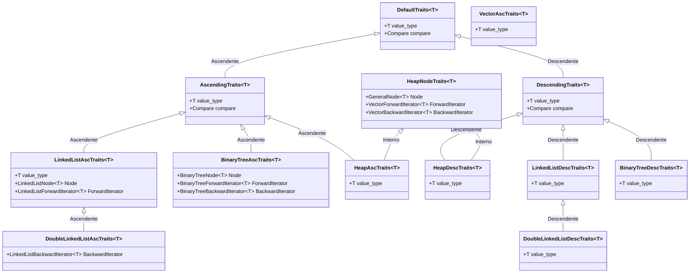
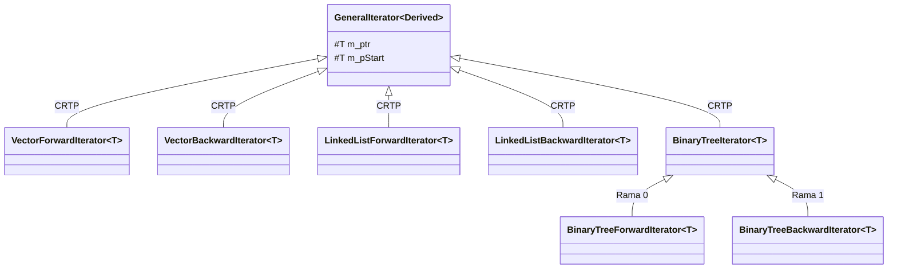
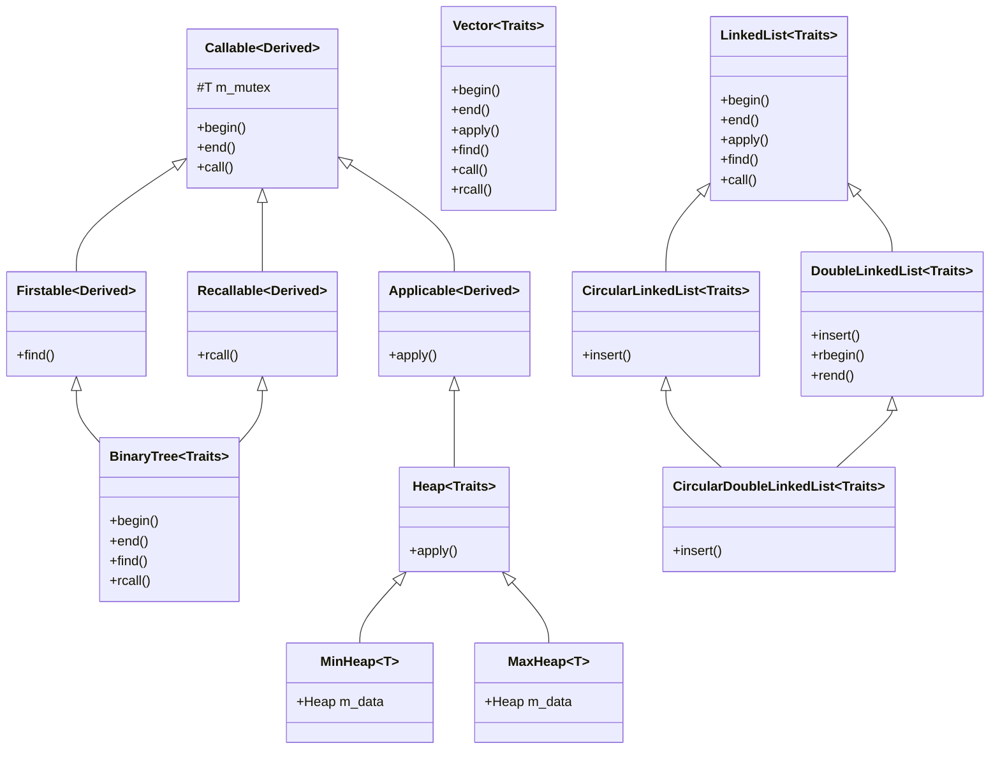
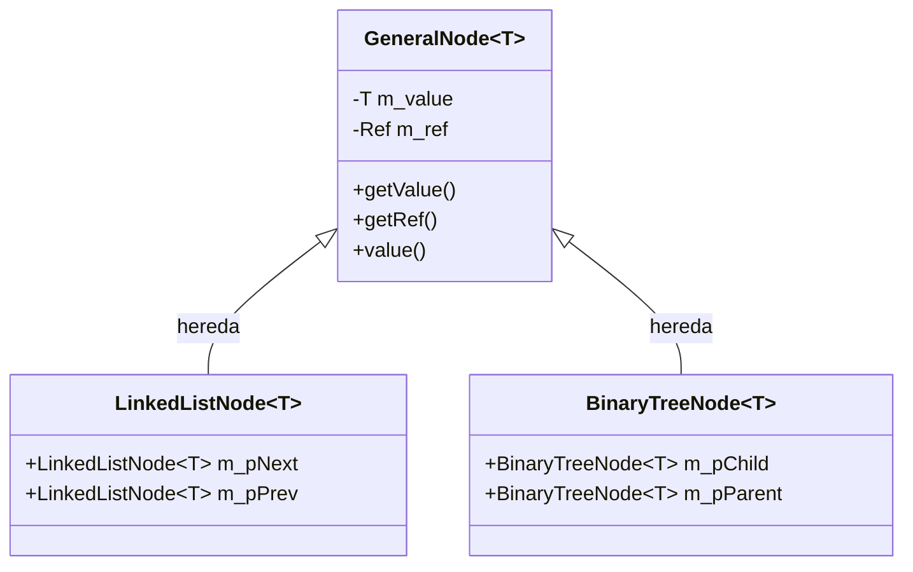

# 2026-II-CS-UNI-CC0E5-AEDAv

## 📦 Contenedores genéricos en C++23

Implementación de **contenedores de datos genéricos** en **C++23**:

- `Vector`
- Listas enlazadas: `LinkedList`, `DoubleLinkedList`, `CircularLinkedList`, `CircularDoubleLinkedList`
- `BinaryTree`
- `Heap`, con sus variantes `MinHeap` y `MaxHeap`

El diseño se sustenta en tres bloques:

1. **Traits**: describen el nodo, los iteradores y el comparador de cada contenedor.
2. **Iteradores**: implementados con el patrón **CRTP** (`GeneralIterator`).
3. **Funciones genéricas de recorrido**: `call`, `ApplyFunction`, `FirstThat`, `rcall`.

Además se incorpora sincronización con `mutex` y persistencia con `operator<<` / `operator>>`.

## 🧩 1. Jerarquía de clases de los Traits

Los contenedores genéricos se parametrizan con un struct de **traits** que define el tipo de valor (`value_type`), el nodo (`Node`), los iteradores (`ForwardIterator` / `BackwardIterator`) y el comparador (`Compare`).



## 🔁 2. Jerarquía de clases de los Iteradores

Los iteradores concretos heredan de `GeneralIterator`, un template basado en **CRTP** que mantiene la posición actual (`m_ptr`) y el inicio (`m_pStart`).



## 📚 3. Jerarquía de clases de los Contenedores

Los contenedores se apoyan en *mixins* de herencia virtual sobre la base `Callable`, e implementan sus propios métodos de recorrido.



## 🧩 4. Jerarquía de clases de los Nodos

Los contenedores trabajan sobre nodos genéricos que agrupan el valor (`m_value`) con una referencia (`m_ref`) al propietario del dato.



- `GeneralNode<T>`: nodo base que guarda el valor (`m_value`) y la referencia (`m_ref`).
- `LinkedListNode<T>`: agrega los enlaces `m_pNext` / `m_pPrev` para el nodo enlazado.
- `BinaryTreeNode<T>`: agrega los hijos (`m_pChild`) y el padre (`m_pParent`) para el árbol binario.

## 🛠️ Compilar y ejecutar

```bash
make
make run
```
